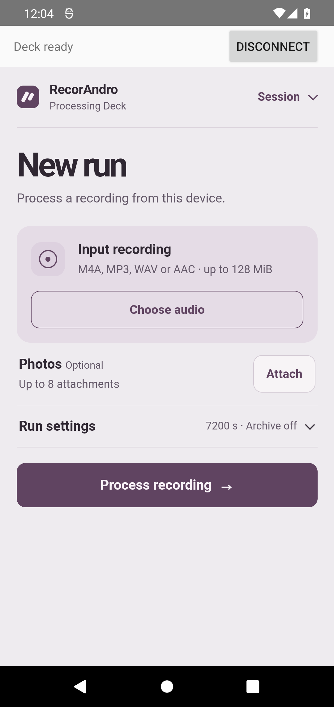

# RecorAndro Companion v0.2.0 Android RC1

RecorAndro Companion brings the local Processing Deck into an Android app.
Start the adapter in Termux, pair locally, choose a recording, and follow
processing through to verified part ZIPs. Termux runs Python and FFmpeg and
stores the originals and sessions. [Install and run](https://github.com/LOPIXdev/RecorAndro/blob/main/docs/ANDROID_COMPANION_RELEASE_EVIDENCE.md#redmi-owner-test-sheet)

*The signed RC1 connected to the Processing Deck on an Android 12 emulator.*

**Signed APK** `recorandro-companion-v0.2.0-android-rc1-final.apk`  
**SHA-256** `fdde3569ea2b759fc7acf1c74097db254c799c4af6b23594ed30b1b184700403`

The owner verified installation, launch, completed audio processing and
visible verified ZIP exports on the A4 debug build on a Redmi Note 10 Pro.
Final RC1 Redmi acceptance, native Save As, Share, and interruption recovery
remain pending. [Release evidence](https://github.com/LOPIXdev/RecorAndro/blob/main/docs/ANDROID_COMPANION_RELEASE_EVIDENCE.md)
